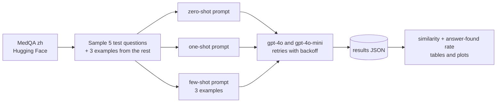

# Zero-, One- and Few-Shot Prompting on Medical QA

**Comparing zero-, one- and few-shot prompts for GPT-4o and GPT-4o-mini on Chinese medical exam questions (MedQA), and why five questions per setting couldn't tell the strategies apart.**

[](https://colab.research.google.com/github/dojedaro/prompt-engineering-few-shot-learning/blob/main/notebooks/Gen_AI_Prompt_Engineering.ipynb)
[](https://github.com/dojedaro/prompt-engineering-few-shot-learning/actions/workflows/notebooks.yml)

## Results

Data: `bigbio/med_qa` (Chinese subset, `med_qa_zh_bigbio_qa`). 5 test questions, with 3 examples drawn
from the remaining questions for the few-shot prompt. Temperature 0.7, up to 200 output tokens.

| Model | Strategy | Answer found in response | Mean string similarity |
|---|---|---|---|
| gpt-4o | zero-shot | 1 / 5 | 0.069 |
| gpt-4o | one-shot | 1 / 5 | 0.118 |
| gpt-4o | few-shot | 1 / 5 | 0.100 |
| gpt-4o-mini | zero-shot | 1 / 5 | 0.106 |
| gpt-4o-mini | one-shot | 1 / 5 | 0.168 |
| gpt-4o-mini | few-shot | 1 / 5 | 0.083 |

**The honest reading: this run can't rank the strategies.** Every configuration found the answer in
exactly 1 of 5 responses, and the differences in similarity are smaller than their standard deviations
(up to 0.22). Three design problems explain why, and fixing them is the real lesson:

1. **Five questions per cell.** One question changes the rate by 20 points. Separating strategies
   that differ by a few points needs hundreds of questions.
2. **The wrong metric for free text.** "Similarity" is a character-sequence ratio between a gold
   answer such as 发绀 (two characters) and a full-sentence reply, so a correct answer like
   "法洛四联症最早且主要的表现是心脏杂音和发绀" still scores low.
3. **No answer format.** MedQA is multiple choice. Asking for the option letter at temperature 0 and
   scoring it exactly would make every response gradable.

## How it works



The comparison is a small class (`GPT4oPromptComparison`) that builds each prompt type, calls both
models with retries and exponential backoff, logs every call, and saves raw responses to JSON so the
analysis can be rerun without new API calls.

## Run it

```bash
pip install -r requirements.txt
cp .env.example .env     # add OPENAI_API_KEY
jupyter notebook notebooks/Gen_AI_Prompt_Engineering.ipynb
```

The notebook has a placeholder where the key goes; reading it from the environment is safer. Results
are written to `results/prompt_engineering_results.json`.

## Stack

Python, OpenAI API, Hugging Face Datasets, pandas, Matplotlib, seaborn.

## Next steps

- 200+ questions per configuration, the same questions for every strategy, temperature 0.
- Ask for the option letter and score exact matches, with 95% confidence intervals per cell.
- Add chain-of-thought as a fourth strategy, since it is often the bigger lever on medical reasoning.

## License

MIT
